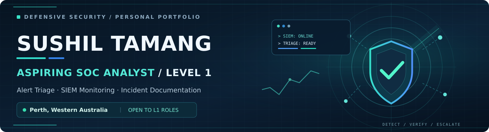
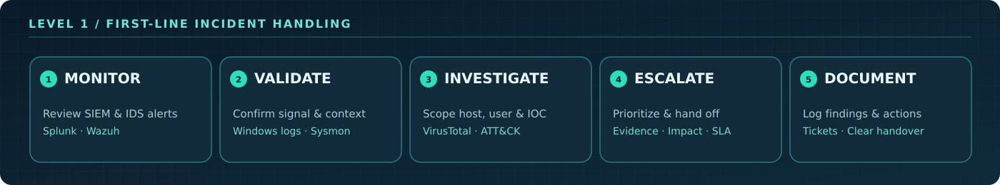

# Ryalghost-SusheelTmz
<!--
  Sushil Tamang | GitHub Profile README
  Designed for SOC Analyst (Level 1) applications.
  To display on your GitHub profile, add this README.md and the assets/ folder
  to a PUBLIC repository named exactly the same as your GitHub username.
  Please add links to your real project repositories after publishing them.
-->

  

   

  
  
  

  
<strong>IT Support background • Hands-on defensive security labs • Seeking an entry-level SOC opportunity</strong>

  
  
  

---

## 👋 About Me

I'm an **IT support professional and Master of Information Technology (Cybersecurity) student** based in Western Australia, working towards my **first SOC Analyst (Level 1)** role.

My professional experience at **Extratech Pty Ltd** includes troubleshooting Windows endpoints, responding to malware and access-related issues, supporting Microsoft Entra ID and MFA, administering Intune, and documenting and escalating service tickets. Alongside that experience, I've built **hands-on SOC home labs** to practise security monitoring, event analysis, alert triage, threat intelligence enrichment, and incident documentation.

I enjoy turning raw logs into a clear story: **what happened, which systems might be affected, what the evidence supports, and when to escalate**.

> 🎯 **Career focus:** SOC Analyst (L1) · Junior Cybersecurity Analyst · Security Operations Centre Analyst — **Perth, WA**
>
> My SOC experience is primarily **lab-based**; my professional experience is in **IT support**. I'm looking to apply both in a real security operations team.

## 🔍 How I Approach Level 1 SOC Triage

  

| L1 responsibility | Practical experience |
| :--- | :--- |
| **Alert monitoring & initial triage** | Review Splunk and Wazuh alerts; examine endpoint and network telemetry in simulated environments. |
| **Log investigation** | Analyse Windows events, Sysmon telemetry, and Suricata IDS alerts to identify suspicious activity. |
| **Initial enrichment** | Use VirusTotal findings, source/destination context, and MITRE ATT&CK mapping to assess a signal. |
| **Classification & escalation** | Capture relevant evidence, describe potential impact, and provide clear handover notes to the next support tier. |
| **Incident documentation** | Apply ticketing, SLA awareness, structured troubleshooting, and communication habits gained from IT support. |

## 🧪 Featured SOC & Cybersecurity Labs

### 01 · 🛡️ Automated Threat Detection & Active Response SOC Lab

`Wazuh` · `pfSense` · `VirusTotal` · `Windows/Linux` · `VMware` · `MITRE ATT&CK`

- Built a **simulated financial-enterprise SOC lab** with segmented networks, monitored endpoints, and centralized security events.
- Integrated **VirusTotal**, configured **File Integrity Monitoring (FIM)**, and mapped events to MITRE ATT&CK techniques.
- Developed a **Wazuh Active Response** script for malicious-file removal, achieving a response time of **under two seconds in a controlled lab test**.
- Ran CIS security configuration assessments and vulnerability checks to identify hardening gaps.

**L1 takeaway:** Understand the signal, verify the indicator, check the affected asset, and document why an alert needs attention.

### 02 · 📊 Splunk SIEM & Network Threat Detection Home Lab

`Splunk Enterprise` · `Suricata IDS` · `Universal Forwarder` · `Kali Linux` · `Hydra`

- Centralized Windows and Linux logs using **Splunk Universal Forwarders**.
- Sent Suricata network intrusion alerts to Splunk for analysis and visualization.
- Simulated brute-force and exploitation activity in an isolated lab to validate detection visibility.
- Built dashboards and searches to investigate suspicious endpoint and network behavior.

**L1 takeaway:** Correlate multiple log sources before deciding whether an alert is a true positive or requires further analysis.

### 03 · 🪟 Active Directory Threat Detection & SIEM Lab

`Active Directory` · `Windows Event Logs` · `Sysmon` · `Splunk` · `Atomic Red Team`

- Configured a Windows domain lab to study identity activity and endpoint security telemetry.
- Ingested Windows event data into Splunk for basic detection and investigation exercises.
- Generated test telemetry with **Atomic Red Team** and Kali Linux.
- Documented findings, evidence, and escalation context during simulated investigations.

**L1 takeaway:** Build confidence identifying suspicious authentication and endpoint behavior from Windows logs.

### 04 · 🤖 Home SOC with AI-Assisted Alert Summarization

`Wazuh` · `Grafana` · `NetAlertX` · `Docker` · `AIRIA AI` · `ZimaCube 2`

- Built a home SOC environment integrating endpoint security events and network discovery data.
- Created a **Grafana dashboard** to bring monitoring and security indicators into one view.
- Integrated an AI assistant to summarize alerts into analyst-readable context.

**L1 takeaway:** Use AI as a supporting tool for summarization, while **human verification and evidence** remain central to triage.

<strong>➕ More security projects</strong>

**Web Application Security & WAF Lab** — Deployed SafeLine WAF as a reverse proxy, configured HTTPS/TLS, and analysed traffic during authorized DVWA tests using VMware, Ubuntu, Apache and Kali Linux.

**Web Platform Vulnerability Assessment (Capstone)** — Assessed a deliberately vulnerable web application using OWASP ZAP, Nessus, Wireshark and Burp Suite; summarized remediation priorities with Power BI.

<!-- Add links to your OWN published lab repositories above, once available. -->

## 🚨 Example: How I'd Triage a Suspicious Sign-In Alert

*Illustrative L1 practice scenario — not a claim of handling a production SOC incident.*

| Step | Initial analyst action |
| :--- | :--- |
| **1. Review the alert** | Confirm alert time, host, account, source IP, and detection rule. |
| **2. Validate the evidence** | Check relevant Windows authentication logs (for example, Event ID `4625` for failed sign-ins) and nearby successful logons. |
| **3. Establish context** | Assess frequency, source location, affected accounts, and whether the behavior is expected. |
| **4. Assess & escalate** | Record indicators, possible impact, evidence links, and an escalation recommendation according to the playbook. |
| **5. Document the outcome** | Write clear case notes so another analyst can quickly continue the investigation. |

## 🧰 Tools & Technologies

**Security monitoring & investigation**

**Systems, networking & scripting**

## 💼 Relevant IT Support Experience

**IT Support Specialist (Part-time) | Extratech Pty Ltd**  
*October 2023 – January 2025 · Hurstville, NSW*

- Supported endpoint security, antivirus protection, identity/access management, MFA, and Windows troubleshooting.
- Worked with **Active Directory, Entra ID, Intune, Group Policy, DHCP, DNS, and VPNs**.
- Logged, prioritized and escalated technical incidents using **Zendesk**, with attention to SLA requirements and clear communication.

These foundations support the day-to-day discipline required in an L1 SOC: **technical investigation, prioritization, user context, ticket quality, and timely escalation**.

## 🎓 Education & Certifications

**Education**
- **Master of Information Technology (Cybersecurity)** — Kaplan Business School *(in progress)*
- **Bachelor of Information Technology** — Kent Institute of Sydney *(2022-2024)*

**Certifications & training listed on my resume**

**Academic recognition:** High Achiever — Cyber Security & Digital Forensics (2026); Intermediate Programming & IT Project Management (2025).

## 🌱 Currently Developing

- More repeatable **alert-triage write-ups**, including log evidence, investigative steps, and escalation decisions.
- Stronger **Windows/Sysmon** and network detection analysis through home lab exercises.
- Practical familiarity with **SOC playbooks, prioritization, false-positive review, and defensive security operations**.

## 📬 Let's Connect

I'm interested in **SOC Analyst (Level 1)** and **Junior Cybersecurity Analyst** opportunities in **Perth, Western Australia**, including onsite and rostered environments.

- **LinkedIn:** [linkedin.com/in/sushiltamang10](https://www.linkedin.com/in/sushiltamang10/)
- **Email:** [Susheelphakrin@gmail.com](mailto:Susheelphakrin@gmail.com)

  Built with curiosity, practical labs, and a commitment to clear security investigation.

<!--
OPTIONAL GITHUB STATS — enable after replacing YOUR_GITHUB_USERNAME.

  

-->
